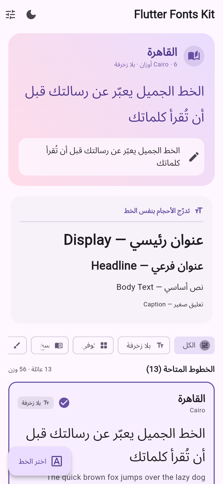
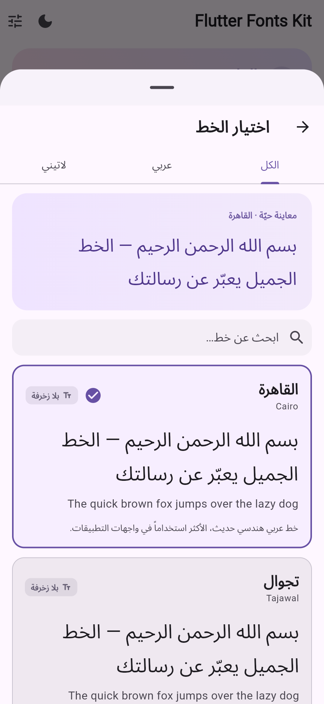
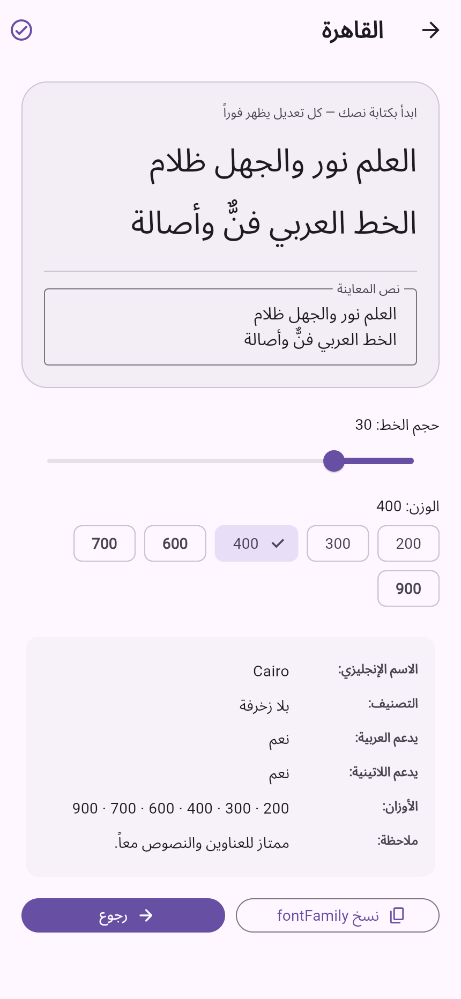
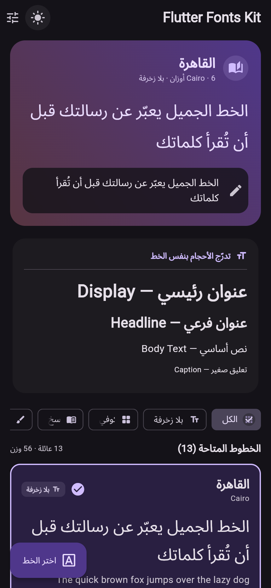

<div dir="rtl">


<h1 align="center">Flutter Fonts Kit — مكتبة الخطوط لتطبيقات Flutter</h1>

مكتبة **جاهزة للاستخدام** تضم **13 عائلة خطية** عربية ولاتينية مضمّنة داخل الحزمة
(56 وزناً)، مع أدوات لاختيار الخط ومعاينته وتطبيقه على كل التطبيق بضغطة زر.

## ✨ المميزات

### الخطوط والتشغيل دون اتصال

- **13 عائلة خطية مضمّنة:** 9 عربية و4 لاتينية، بإجمالي **56 وزناً**.
- **58 ملف TTF:** الأوزان السابقة مع نسختين مائلتين لخط Amiri.
- **بلا تنزيل وقت التشغيل:** الخطوط داخل الحزمة، ولا يحتاج عرضها إلى اتصال
  بالإنترنت بعد تثبيت الاعتماديات وبناء التطبيق.
- **أوزان ثابتة:** الخطوط المتغيّرة حُوّلت إلى نسخ ثابتة منفصلة لاتساق العرض.
- **تراخيص واضحة:** كود المكتبة MIT، والخطوط OFL-1.1 مع نسخ التراخيص في `licenses/`.

### التحكم في الخط والثيم

- `FontKit` مع `FontKitScope`: تغيير الخط وتحديث الودجات التي تعتمد على النطاق.
- `applyTo(ThemeData)`: تطبيق العائلة الحالية على ثيم التطبيق.
- `textScale`: معامل مقياس النص بين **0.5 و3.0**، ويستخدمه المثال عبر
  `MediaQuery.textScaler`.
- `next()` و`previous()` للتنقل بين العائلات، و`reset()` للعودة للافتراضي.
- `KitText`: نص بخط المكتبة مع التحكم في الحجم والوزن واللون والمحاذاة وعدد الأسطر.

### منتقي الخطوط والمعاينة

- منتقي كصفحة كاملة عبر `FontPickerPage` أو `showFontPicker`.
- لوحة سفلية عبر `showFontPickerSheet`، وزر جاهز عبر `FontPickerButton`.
- بحث عربي/إنجليزي، وتبويبات **الكل / عربي / لاتيني**، ومعاينة حيّة وعلامة للخط المحدد.
- `FontSpecimen`: بطاقة معاينة بنص عربي ولاتيني، مع الأوزان والوصف والتصنيف.
- سجل `KitFonts`: تصفية بالعربية أو اللاتينية أو التصنيف، وقوائم مخصصة للنصوص
  والعناوين، واسترجاع عائلة باسمها عبر `byFamily()`، وبحث نصي عبر `matches()`.

### التطبيق التجريبي والفحص

- واجهة عربية RTL، ووضع ليلي/نهاري، وصفحة تفاصيل لكل خط.
- معاينة الأحجام والأوزان ونسخ `fontFamily` من صفحة التفاصيل.
- **22 اختباراً تلقائياً:** 20 للمكتبة و2 للمثال.
- سير عمل CI مضبوط لتشغيل `flutter analyze` والاختبارات ثم بناء مثال الويب.

---

## 📸 لقطات الشاشة

| الرئيسية | منتقي الخطوط | تفاصيل الخط | الوضع الليلي |
|:---:|:---:|:---:|:---:|
|  |  |  |  |

> الصور مأخوذة من التطبيق التجريبي الفعلي (`example/`) بعد بناء الويب. لقطات
> الشاشة مولّدة عبر Chromium + Playwright بمقاس iPhone 430×932 @2x.

---

## ⬇️ التنزيل والتشغيل على Windows

الأوامر التالية مخصّصة لـ **PowerShell**. نفّذ كل سطر على حدة وبالترتيب،
ولا تحتاج إلى Bash أو WSL. إذا ظهر خطأ، توقّف واحتفظ بنصّه الحرفي.

### المتطلبات

- **Flutter SDK بإصدار 3.27 أو أحدث**، مع **Dart 3.6 أو أحدث** المضمّن معه.
  هذا هو الحد الأدنى المطلوب لاستخدام `Color.withValues` في الودجات.
- **Git** لتنزيل المشروع بأمر `git clone`، وهو موجود على جهازك بالفعل.
- **Google Chrome** لتشغيل نسخة الويب.
- لتشغيل تطبيق Windows مستقل: **Visual Studio 2022** مع حِمل
  **Desktop development with C++**. هذه المتطلّبات غير لازمة لنسخة Chrome.

### 1) تحقّق من الأدوات

```powershell
flutter --version
git --version
flutter doctor
```

**النتيجة المتوقعة:** يظهر إصدار Flutter وإصدار Git وتقرير بأدوات التطوير.
إذا لم يتعرّف PowerShell إلى `flutter`، أصلح إضافته إلى `PATH` وأعد فتح
PowerShell قبل المتابعة. ركّز في تقرير `flutter doctor` على الأداة التي تريد
التشغيل عليها؛ لا يلزم إصلاح أدوات Android مثلًا لتشغيل نسخة Chrome.

### 2) نزّل المشروع — اختر طريقة واحدة

**أ) نسخة جديدة باستخدام Git**

```powershell
Set-Location "C:\Users\KING\Desktop\ns"
git clone https://github.com/semi22gmil-maker/flutter-fonts-kit.git
Set-Location ".\flutter-fonts-kit"
```

**النتيجة المتوقعة:** ينشئ Git مجلد `flutter-fonts-kit` ويصبح مجلد العمل الحالي،
وتجد داخله `pubspec.yaml` و`README.md` و`example`.
إذا كان المجلد موجوداً بالفعل، لا تكرر التنزيل فوقه؛ استخدم الخيار «ج» أدناه.

**ب) تنزيل ZIP دون أمر Git**

افتح [صفحة المستودع](https://github.com/semi22gmil-maker/flutter-fonts-kit)،
ثم اختر **Code → Download ZIP**. يمكنك أيضاً استخدام
[رابط التنزيل المباشر](https://github.com/semi22gmil-maker/flutter-fonts-kit/archive/refs/heads/main.zip).

فكّ الضغط بالكامل، ثم افتح PowerShell داخل المجلد المستخرج الذي يحتوي
`pubspec.yaml` و`example`. لا تشغّل المشروع من داخل نافذة الملف المضغوط.
انتقل مباشرة إلى الخطوة 3.

**ج) استخدام نسختك الموجودة بالفعل**

```powershell
Set-Location "C:\Users\KING\Desktop\ns\flutter-fonts-kit"
```

**النتيجة المتوقعة:** يصبح مجلد المشروع الحالي هو مجلد العمل. هذه الطريقة
تشغّل ملفاتك الحالية، ولا تحذف تعديلاتك المحلية ولا تستبدلها بنسخة GitHub.

### 3) جهّز الحزمة وشغّل المثال في Chrome

نفّذ الأوامر التالية من جذر المشروع:

```powershell
flutter pub get
Set-Location ".\example"
flutter pub get
flutter devices
flutter run -d chrome
```

**النتيجة المتوقعة:** تُجلب اعتماديات الحزمة والمثال، ويظهر Chrome ضمن
الأجهزة المتاحة، ثم يُبنى التطبيق التجريبي وتُفتح نافذة معاينة الخطوط.
قد يستغرق البناء الأول وقتاً أطول. إذا لم يظهر Chrome في `flutter devices`،
تحقّق من تثبيته قبل تنفيذ أمر التشغيل.

ملفات الويب موجودة في `example/web`، والمثال يعتمد على الحزمة المحلية عبر
`path: ../`؛ لذا لا تحتاج إلى نشر الحزمة على pub.dev لتجربتها.

### 4) اختياري: التشغيل كتطبيق Windows

من داخل مجلد `example` بعد تنفيذ `flutter pub get`، أنشئ ملفات منصة Windows
الناقصة في المستودع:

```powershell
flutter create . --platforms=windows --project-name flutter_fonts_kit_example
flutter run -d windows
```

**النتيجة المتوقعة:** يُنشئ Flutter ملفات مشروع Windows داخل `example`،
ثم يفتح التطبيق في نافذة مستقلة، بشرط اكتمال أدوات Visual Studio المذكورة.
إذا لم تكن الأدوات مثبتة، استخدم Chrome؛ ولا تفترض نجاح تشغيل Windows قبل
ظهور نافذة التطبيق.

---

## 🔤 الخطوط المتضمنة (13 عائلة / 56 وزناً)

### الخطوط العربية (9 عائلات)

| الخط | الاسم | الأوزان | التصنيف | الاستخدام المقترح |
|---|:---:|:---:|:---:|---|
| **Cairo** | القاهرة | 200 · 300 · 400 · 600 · 700 · 900 | بلا زخرفة | العناوين والنصوص — الأكثر شيوعاً |
| **Tajawal** | تجوال | 200 · 300 · 400 · 500 · 700 · 800 · 900 | بلا زخرفة | فقرات ومحتوى طويل |
| **Almarai** | المراعي | 300 · 400 · 700 · 800 | بلا زخرفة | شاشات صغيرة وقوائم |
| **IBM Plex Sans Arabic** | آي بي إم بلكس | 100 → 700 (7 أوزان) | بلا زخرفة | تطبيقات مؤسسية |
| **Noto Kufi Arabic** | نوتو كوفي | 300 · 400 · 500 · 700 | كوفي | عناوين وشعارات |
| **Reem Kufi** | ريم كوفي | 400 · 500 · 600 · 700 | كوفي | عناوين كبيرة وزخرفية |
| **Amiri** | أميري | 400 · 700 (+ مائل) | نسخ | اقتباسات وكتب |
| **Aref Ruqaa** | عارف رقعة | 400 · 700 | رقعة | بطاقات وعناوين يدوية |
| **Scheherazade New** | شهرزاد | 400 · 500 · 600 · 700 | نسخ | نصوص مطوّلة |

### الخطوط اللاتينية (4 عائلات)

| الخط | الأوزان | التصنيف |
|---|:---:|:---:|
| **Poppins** | 400 · 500 · 600 · 700 | هندسي |
| **Montserrat** | 300 → 700 | هندسي |
| **Inter** | 400 · 500 · 600 · 700 | واجهات |
| **Roboto** | 400 · 500 · 700 | واجهات |

---

## 📦 استخدام المكتبة في مشروع Flutter آخر

إذا أردت تشغيل المشروع الذي نزّلته كما هو، اتبع قسم **التنزيل والتشغيل**
أعلاه. أما لإضافة المكتبة إلى تطبيقك، فاختر أحد المصدرين التاليين.

### 1) من GitHub مباشرة

أضف ما يلي إلى `pubspec.yaml` في تطبيقك، تحت `dependencies`:

```yaml
dependencies:
  flutter_fonts_kit:
    git:
      url: https://github.com/semi22gmil-maker/flutter-fonts-kit.git
      ref: main
```

ثم نفّذ من جذر تطبيقك في PowerShell:

```powershell
flutter pub get
```

**النتيجة المتوقعة:** يجلب Flutter المكتبة من المستودع ويسجّل خطوطها تلقائياً.
يحتاج هذا الخيار إلى اتصال بالإنترنت عند جلب الاعتماديات، لكن عرض الخطوط
بعد تضمين الحزمة لا يحتاج إلى تنزيلها من الشبكة.

### 2) من نسخة محلية

إذا كان تطبيقك ومجلد `flutter-fonts-kit` مجلدين شقيقين، أضف:

```yaml
dependencies:
  flutter_fonts_kit:
    path: ../flutter-fonts-kit
```

ثم نفّذ من جذر تطبيقك:

```powershell
flutter pub get
```

**النتيجة المتوقعة:** يستخدم تطبيقك النسخة المحلية مباشرة. عدّل المسار إذا
كان ترتيب المجلدات مختلفاً؛ يجب أن يشير إلى المجلد الذي يحتوي `pubspec.yaml`
الخاص بالمكتبة.

> الخطوط مسجّلة في `pubspec.yaml` الخاص بالحزمة، وFlutter يضمّها عند البناء.
> لا تحتاج إلى نسخ ملفات TTF إلى تطبيقك أو تسجيلها مرة أخرى.

---

## 🚀 البدء السريع

```dart
import 'package:flutter/material.dart';
import 'package:flutter_fonts_kit/flutter_fonts_kit.dart';

void main() => runApp(const DemoApp());

class DemoApp extends StatefulWidget {
  const DemoApp({super.key});
  @override
  State<DemoApp> createState() => _DemoAppState();
}

class _DemoAppState extends State<DemoApp> {
  final FontKit kit = FontKit(font: KitFonts.cairo);

  @override
  Widget build(BuildContext context) {
    return AnimatedBuilder(
      animation: kit,
      builder: (context, _) => FontKitScope(
        kit: kit,
        child: MaterialApp(
          // يطبّق خط المكتبة على كل نصوص التطبيق
          theme: kit.applyTo(ThemeData.light(useMaterial3: true)),
          home: Scaffold(
            appBar: AppBar(title: const Text('مكتبة الخطوط')),
            body: Center(
              child: Column(
                mainAxisAlignment: MainAxisAlignment.center,
                children: [
                  KitText('الخط الحالي: ${kit.font.nameAr}', size: 24),
                  const SizedBox(height: 16),
                  FontPickerButton(kit: kit), // زر يفتح منتقي الخطوط
                ],
              ),
            ),
          ),
        ),
      ),
    );
  }
}
```

---

## 🧩 واجهة البرمجة (API)

### `KitFonts` — سجل الخطوط

```dart
KitFonts.all             // كل العائلات (13)
KitFonts.arabic          // الخطوط العربية (9)
KitFonts.latin           // الخطوط اللاتينية (4)
KitFonts.forBodyText     // المناسبة للنصوص
KitFonts.forHeadings     // المناسبة للعناوين
KitFonts.byCategory(KitFontCategory.kufi)
KitFonts.byFamily('Cairo')
KitFonts.cairo           // ثوابت جاهزة لكل خط
```

### `KitFont` — وصف الخط

```dart
final f = KitFonts.cairo;
f.family                 // 'Cairo'  → لـ fontFamily
f.nameAr                 // 'القاهرة'
f.weights                // [200, 300, 400, 600, 700, 900]
f.category.labelAr       // 'بلا زخرفة'
f.textStyle(fontSize: 24, fontWeight: FontWeight.w700)
f.matches('قاهرة')       // true — بحث عربي/إنجليزي
```

### `FontKit` — المتحكّم

```dart
final kit = FontKit(font: KitFonts.cairo);
kit.font = KitFonts.tajawal;   // يحدّث التطبيق كله تلقائياً
kit.next();                    // الخط التالي
kit.previous();                // الخط السابق
kit.textScale = 1.3;           // تكبير النصوص
kit.reset();                   // العودة للافتراضي
kit.applyTo(theme);            // ينسخ ThemeData مع الخط
```

### الودجات

| الودجت | الوظيفة |
|---|---|
| `FontKitScope` | يوفّر المتحكّم لأبناء الشجرة + يُعيد البناء تلقائياً |
| `KitText` | نص بخط المكتبة (`font:` للتحديد اليدوي) |
| `FontSpecimen` | بطاقة معاينة لخط واحد |
| `FontPickerPage` | صفحة اختيار الخطوط (بحث + تبويبات) |
| `showFontPicker(context)` | يفتح الصفحة ويُعيد `KitFont?` |
| `showFontPickerSheet(context)` | نفس الشيء كلوحة سفلية |
| `FontPickerButton(kit: kit)` | زر جاهز يفتح المنتقي ويطبّق النتيجة |

### الوصول من أي مكان

```dart
final kit = context.fontKit;        // FontKit الأقرب
final family = context.currentFontFamily;
```

---

## 🖥️ ما يعرضه التطبيق التجريبي

للتنزيل والتشغيل خطوة بخطوة، راجع قسم **التنزيل والتشغيل على Windows** أعلاه.

التطبيق التجريبي يحتوي:

- معاينة حيّة يتغيّر خطها فوراً، وكتابة نص تجريبي.
- تدرّج أحجام بنفس الخط.
- تصفية حسب التصنيف (كوفي، نسخ، زخرفي…).
- منتقي خطوط كصفحة كاملة أو كلوحة سفلية.
- صفحة تفاصيل لكل خط: شريط الحجم، أزرار الأوزان، نسخ `fontFamily`.
- وضع ليلي/نهاري.

---

## 🧪 الاختبارات

نفّذ من جذر المشروع في PowerShell، كل سطر على حدة:

```powershell
flutter analyze
flutter test
Set-Location ".\example"
flutter analyze
flutter test
Set-Location ".."
```

**النتيجة المتوقعة:** يفحص المحلّل الشيفرة دون أخطاء، وتنجح اختبارات المكتبة
ثم اختبارات المثال. أوامر `Set-Location` الأخيرة تعيدك إلى جذر المشروع.

---

## 🔤 إضافة خط جديد

1. ضع ملفات `.ttf` في `assets/fonts/<اسم-الخط>/`.
2. سجّلها في `pubspec.yaml` تحت `flutter: fonts:` بنفس النمط الموجود.
3. أضف ثابتاً جديداً في `lib/src/kit_fonts.dart` وأضفه إلى `KitFonts.all`.

> سكربت مساعد لجلب الخطوط من مستودع Google Fonts:
> يتطلب Python واتصالاً بالإنترنت، ولا يلزم لتشغيل الخطوط المضمّنة بالفعل.
> ```powershell
> python tool/fetch_fonts.py
> ```

---

## 📄 الترخيص

- **كود المكتبة:** رخصة MIT (انظر `LICENSE`).
- **الخطوط:** كلها من [Google Fonts](https://fonts.google.com) بترخيص
  **SIL Open Font License 1.1** — النسخ الأصلية للتراخيص في مجلد `licenses/`.
  يجوز استخدامها في التطبيقات التجارية، مع بقاء اسم الخط محفوظاً وعدم بيع
  الخطوط منفردة.

---

## 👥 المساهمون

- [semi22gmil-maker](https://github.com/semi22gmil-maker) — صاحب المستودع.

قائمة **Contributors** في GitHub تُبنى تلقائياً من الـcommits المرتبطة بحسابات
مؤلفيها؛ ربط المساهمة بحسابك يحتاج إلى استخدام بريد GitHub الصحيح في الـcommit.

---

## 🤝 المساهمة

المساهمات مرحّب بها: افتح Issue أو Pull Request. قبل الإرسال شغّل:

```powershell
flutter analyze
flutter test
```

</div>
